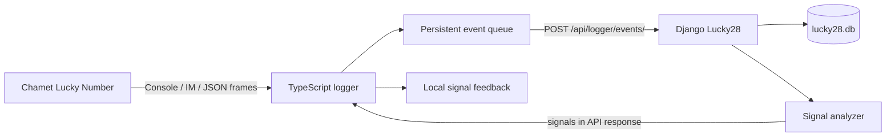

# Lucky28 + Chamet Lucky Number logger

Run the dashboard and logger together from this project:

```bash
python3 run.py
```

The command uses the root `.venv`, installs missing dependencies, compiles the
logger, applies Django migrations, waits for the authenticated API, and opens a
persistent Chrome window. It reuses an already running compatible Django server.
Press **Ctrl+C** to stop the logger and the Django process it started.

You need Python 3.10+, Node.js 22+, npm, and Google Chrome installed. On first
launch, sign in to Chamet in the new window. The logger automatically joins the
first available party, opens its game menu, and chooses **Lucky Number / Lucky 28**. The login
is kept in this project's `.local/chamet-profile`; no browser extension or paths
to another workspace are required. Capture follows the Lucky Number console/IM
packet formats used by the original logger and accepts readable WebSocket JSON.
Automation waits for login when required. Once a game is opened, two minutes
without progress in valid Number Game packets triggers navigation back through
the room and game menu. Unrelated console messages and repeated copies of a
frozen winner do not keep the connection healthy. Set `CHAMET_AUTO_OPEN=false`
for manual navigation; optional party/menu/Number Game selectors are listed in
`.env.example`. Navigation uses one native tap per control, and never clicks Play
or places a bet.

## Commands

| Command | Purpose |
| --- | --- |
| `python3 run.py` | Start Django and the Lucky Number logger |
| `python3 run.py --setup` | Install dependencies, build, and prepare the database |
| `python3 run.py --django-only` | Start only the Django site |
| `python3 run.py --check` | Check dependencies and authenticated API connectivity |
| `python3 run.py --port 8001` | Use another local port for both components |
| `python3 run.py --replay path/to/events.jsonl` | Import captured events without opening Chamet |

The site is at <http://127.0.0.1:8000/>. Choose **Signals → Configuration** to
create signal rules. Without active rules, results are saved and no signals are
returned. The existing standalone Streamlit dashboard can still be run with
`.venv/bin/streamlit run streamlit_lucky28/app.py`; it is not part of this launcher.

## Shared configuration and storage

Both components read the root `.env`. Keep existing values and use
[.env.example](.env.example) to add overrides as needed. Defaults work without
adding logger settings. Setup generates a shared token in `.local/logger-token`
unless `LUCKY28_LOGGER_TOKEN` is supplied. It is sent in the `X-Lucky28-Token`
header. The logger API rejects requests without a matching token.

| Location | Purpose |
| --- | --- |
| `django_lucky28/` | Django site, stored games, analysis, and signal rules |
| `chamet_logger_standalone/src/` | Active Lucky Number capture, mapping, and delivery |
| `lucky28.db` | Shared persistent database; dates remain UTC |
| `.local/chamet-profile/` | Browser profile for this project |
| `.local/chamet/pending/` | Captured events awaiting delivery |
| `.local/chamet/failed/` | Rejected events and their API error details |
| `.local/chamet/delivered.jsonl` | Successfully delivered normalized events |
| `.local/chamet/received-signals/` | Signal feedback deduplicated by signal ID |
| `.local/chamet/signals.jsonl` | Received signal journal |
| `.local/legacy-chamet-logger/` | Preserved original copy, including its nested Git history and race utilities |

The legacy copy is ignored by Git and is not loaded or executed. The copied
`src/tests/chamet_logger.spec.ts` Car Game reference is excluded from the active
TypeScript build. The active logger has no Lucky Race capture, coordinate betting automation, screenshot
exporters, Excel utilities, or dependencies on `master_config.csv`.

## How the APIs connect



- `GET /api/logger/health/` verifies the shared token and API contract version.
- `POST /api/logger/events/` accepts normalized pre-result or winner events and
  returns `{accepted, duplicate, game, signals}`.
- Events carry `schema_version: 1`, `game_type: "lucky28"`, `game_no`, `phase`,
  `observed_at`, and `data`. `observed_at` is the UTC capture time. A queued retry
  keeps that original time, so it cannot move yesterday's results into today.
- Pre-result events capture start, T-10, T-5, and T-0 milestones. Rates convert
  Chamet's proportions into percentages. Winners require status 3 or 4, zero
  remaining seconds, and a result from 0 through 27.
- Retryable failures remain queued. Invalid or conflicting events move to
  `failed/` with the response, allowing later games to proceed. Corrected events
  can be submitted with `--replay`; this writes to the configured database.
- Repeated winners preserve the original result and date. A conflicting winner
  returns HTTP 409. Signal analysis uses history at the event's timestamp, and
  retries return the same signal IDs without creating new signal logs.

The older `/api/games/pre/` and `/api/games/<game_no>/winner/` routes remain for
the existing UI. The active logger uses only the versioned logger contract above.
Its API calls return feedback locally and do not send WhatsApp notifications.

Signal feedback is the foundation for the later decision/acknowledgement flow.
The active logger records and displays signals; it does **not** place bets or
implement the future "bet now" decision protocol.

## Pre-round alerts and Telegram delivery

Open **Alerts** (`/alerts/`) for the complete alert center. Everything is managed
in the regular application UI; Django admin and terminal commands are optional.

- **Overview:** current patterns, activations, frozen evidence, and worker health.
- **Rules:** search/filter, create/edit/delete rules, enable/disable them, or add
  missing defaults. Select values from a list; no JSON or technical keys needed.
- **Destinations:** manage Telegram chats/channels, subscription levels and
  expiry, image cards, result follow-ups, and health warnings. Use **Send test
  message** to explicitly queue a test for that destination.
- **Telegram & worker:** save/replace/remove the bot token, enable delivery,
  adjust health/event timing, and start/stop the worker. Changes apply immediately.
- **Deliveries:** filter the queue/history, view messages and archived cards,
  cancel pending messages, or retry definitively failed deliveries. Uncertain
  deliveries cannot be resent from the UI.

The overview refreshes every 15 seconds. Evidence opens as a readable page with
card preview and JSON export. Management is available locally on `localhost` or
`127.0.0.1` without an admin login; non-local requests require authenticated staff.
Mutation endpoints require POST and CSRF protection. Bot tokens are stored in a
private file (`.local/alerts/bot-token`, mode 0600), never echoed in the UI. The
local token overrides the environment token, including explicit removal.

Setup from the repository root:

```bash
.venv/bin/python django_lucky28/manage.py migrate
.venv/bin/python django_lucky28/manage.py seed_alert_rules
```

`python3 run.py` applies migrations; `--setup` also seeds defaults. The Rules
page has an **Add missing defaults** button. Regular restarts preserve deleted
rules. Seeding installs 79 Lucky28 rules
without overwriting customizations: streaks, droughts, high/low window density,
Big/Small and Odd/Even alternation and streak breakers, and 28 individual number
droughts. The optional every-round rule starts disabled. Number droughts require
destination rank 2; other defaults require rank 1. Rules use exact values
such as Big or Odd/Even, with configurable thresholds, windows,
session scope, and minimum subscription rank (1–5). Semantic changes increment
the revision so the changed condition can activate independently.

The implementation adapts `ALERT_SYSTEM_ARCHITECTURE_AND_LOGIC.md` to the data
available here. Racing lineups, car/road/speed rules, three-model prediction
comparisons, vehicle art, and screenshots have no corresponding Lucky28 inputs.
Cards therefore show number patterns and a 50-result timeline. The document's
empirical racing probabilities are not treated as Lucky28 probabilities.

Each fresh pre-result packet freezes one evaluation, all matching occurrences,
the current rates, up to 1,002 prior results used for patterns, lifetime number
totals, a 50-result timeline, and six previous results. Only results timestamped
before that round are eligible. Continuing conditions remain visible but only
new activations enter the delivery queue (except the explicit every-round rule).
The engine never recalculates saved evidence after winner arrival or a rule edit.
Deleting an archived game retains its alert evidence and delivery records.

CSV imports do not generate alerts. Packets older than 120 seconds, timestamps
more than five seconds in the future, out-of-order pre-rounds, and rounds whose
winner is already known do not create retrospective pre-round alerts. Only fresh,
advancing event timestamps reset collection health. Session-scoped rules reset
on Django server restart; lifetime baselines do not. This launcher uses a single
Django process; session-scoped rules should use a shared epoch before deploying
multiple independent web processes.

Telegram is disabled by default. To enable it entirely from the UI:

1. Open **Alerts → Telegram & worker**, paste your BotFather token, check
   **Enable Telegram delivery**, and save.
2. Open **Destinations**, add your chat ID or channel username, choose its level,
   and enable it. Set expiry and follow-up preferences as needed.
3. Return to **Telegram & worker** and click **Start worker**.
4. Use **Send test message** on the destination and check **Deliveries**.

No server restart is needed. **Stop worker** lets any in-flight request finish,
then stops polling. The worker remains separate from the web server. For CLI
users, the equivalent is:

```bash
.venv/bin/python django_lucky28/manage.py run_alert_messaging
```

The worker is intentionally separate from `run.py`. `--once` processes one batch
and exits. It uses a POSIX file lease (macOS/Linux), atomic conditional database
claims, a two-second polling interval, and bounded error backoff. Keep the same
`.local/alerts` directory for workers sharing this database. Telegram calls run
only in this worker; ingestion never makes Telegram HTTP requests.

Deliveries are filtered by rank and expiry at enqueue time and checked again
before dispatch. Already completed rounds and stale queued alerts are cancelled.
Opt-in result follow-ups use their own frozen snapshot and require a confirmed
original alert. Destination records represent channel or direct-message
subscriptions; billing, Telegram join approval, invitation creation, and member
removal are not implemented.

Pillow renders 1080-pixel JPEG cards under 400KB. A two-second render timeout or
render failure falls back to escaped HTML text. Messages respect Telegram's
[text and photo caption limits](https://core.telegram.org/bots/api#sendphoto).
Exact outgoing HTML and any image are archived under `.local/alerts/artifacts/`.

Delivery states are `pending`, `sending`, `sent`, `uncertain`, `failed`, or
`cancelled`. A rate-limit response explicitly rejecting the request schedules a
retry. Network errors, server errors, malformed success responses, and abandoned
claims become **uncertain and are never automatically resent**. This favors
avoiding duplicates over guaranteed delivery: Telegram provides no idempotency
key for these send methods. Inspect uncertain records and the target chat
manually; the UI only offers retries for definitively failed deliveries, never uncertain ones.

After three minutes without fresh events, the worker queues one health warning
per destination. It re-arms after ingestion resumes. The monitor shows the last
worker heartbeat, and `/api/alerts/latest/` exposes the latest frozen evaluation.

## Color group absence alerts

Open **Alerts → Group absence** (`/alerts/groups/`) and select **Edit thresholds**.
The seven groups use the requirements document's exact membership: Red
(0, 1, 26, 27), Orange (2, 3, 24, 25), Magenta (4, 5, 22, 23), Blue
(6, 7, 20, 21), Cyan / Teal (8, 9, 18, 19), Green (10, 11, 16, 17), and
Grey (12, 13, 14, 15). Stable IDs G01–G07 and their membership live in
`games/group_config.py`. Existing Yellow/Pink rules keep their original labels.

New group alerts start **disabled, with no thresholds**. Enter your own positive
whole-round thresholds (maximum **1,000,000**), enable the desired groups and global
delivery, and select **Save settings**. Apply to all only populates editable fields;
Cancel discards edits. Saves are atomic and record old/new values, editor and time.
Local access records “Local operator”; authenticated staff records their username.
The screen shows the latest 50 changes; the full audit remains in the database.
No restart or daily reset is needed. Dates use Django's configured `TIME_ZONE`.

A hit resets a group to zero; each other valid completed round adds one. Counts
and notification markers survive restarts, threshold edits, disabling and midnight.
An unseen group explicitly shows an unknown last appearance and a lower-bound
count. Each current absence produces one durable event, with one delivery per
eligible destination. Reaching the threshold while delivery is paused records no
new event until re-enabled. Raising the threshold retains notification history.
The regular Telegram destinations and worker deliver these messages as text.
Optionally set `ALERT_PUBLIC_BASE_URL` to the app's externally reachable HTTP(S)
origin to include clickable round-detail links; otherwise messages show the local
in-app details path. The dashboard always links directly to the round.

The feed is expected to have consecutive round IDs, as confirmed for this feature.
Numeric IDs, or IDs with a shared prefix followed by integers (e.g. R100, R101),
are ordered numerically. IDs establish continuity only; absence counts count
observed rounds, never ID differences. Known gaps, invalid winners, missing
completion timestamps, cancelled results and unfinished rounds preceding a later
winner pause the entire affected stream. The open next round is allowed.
Incompatible historical ID formats also pause delivery because continuity cannot
be established. Historical imports with synthetic IDs must be reconciled with
source round IDs before these alerts can deliver. No results are automatically
deleted or fabricated to repair gaps. The application groups legacy blank game
names with Lucky28, matching its existing history behavior.

Live ingestion updates counters and the outbox transactionally. Imports, admin
corrections and deletions invalidate the persisted counters; the next dashboard
read, worker cycle or live result rebuilds ordered history. Rebuilds evaluate only
the latest state and preserve notification evidence; they never replay historical
threshold crossings. `python3 run.py` restores counters after migration. A manually
started server restores them on first use; an explicit catch-up is also available:

```bash
.venv/bin/python django_lucky28/manage.py sync_group_absence
```

Group alerts have a separate event history and use the existing durable delivery
queue. Before dispatch, unsent messages refresh their count, threshold and last
appearance from reconciled state while retaining the same delivery key and original
event history. Paused/incomplete/below-threshold events remain pending, and an appearance
cancels unsent obsolete deliveries while retaining history. Rate limits and local
archive failures retry the same event/delivery key. Definitively rejected Telegram
requests remain available for the existing manual Retry action. Network failures,
server errors and abandoned in-flight claims are **uncertain**, never automatically
resent: Telegram does not support send-message idempotency, so an ambiguous retry
could duplicate a notification. No worker or real notifications are enabled by
installing this feature.

Acceptance coverage is in `games.tests.test_group_absence` (AC01–AC15), with existing
alert tests covering AC16. `scripts/check_alert_ui.py` also checks browser validation,
Apply to all, explicit save, persistence, Cancel, group history, and desktop/mobile
screens against an isolated database.

## Recent 10-game drought and repeat alerts

Open **Alerts → Recent 10 games** (`/alerts/windows/`), or **Configure 10-game
alerts** beside the analysis table. Each new completed result advances a rolling
window of exactly ten results, across midnight and service restarts.

- **Drought:** all ten results are different. For example,
  `0, 2, 4, 6, 8, 10, 12, 14, 16, 18`. Send one alert when this condition starts;
  continuing all-different windows do not resend. A window containing a repeat
  allows the next all-different period to alert again.
- **Repeat:** the newest result matches one of the previous nine. If the next
  result in that example is `8`, the new window is
  `2, 4, 6, 8, 10, 12, 14, 16, 18, 8`, triggering one repeat alert for that round.
  An earlier pair remaining in the window does not alert again when the newest
  result is different. A match ten rounds back has already left the window.

The two switches start disabled and are saved explicitly. Enabling evaluates the
current window once. Counts, settings and event keys persist; refreshing, repeating
an event, saving again or restarting does not duplicate notifications. Startup and
late corrections do not replay old windows. A separate history records the ten
numbers, round range, type and repeated-number counts. The analysis table uses the
same repetition calculation and labels all-different windows as droughts.

These alerts require ten consecutive valid completed rounds in their own stream.
Pending, invalid or missing rounds inside that window pause evaluation; historical
gaps outside it do not prevent a new complete window from working. The current
round is selected by result timestamp, then consecutive round IDs establish its
window. Corrected or deleted evidence cancels affected unsent messages. Messages
use the existing Telegram destinations, worker and retry/uncertain-delivery policy.
They expire using the Telegram worker's configured maximum event age (120 seconds
by default), and contain the observed window rather than a prediction.

`python3 run.py` migrates and restores this feature automatically. For a manually
started server, run migrations first; state restores on the first page request,
result or worker cycle. `sync_window_alerts` explicitly restores current state.
Tests are in `games.tests.test_window_alerts`, with browser coverage in
`scripts/check_alert_ui.py`.

## Row, column and SE/BE/BO/SO alerts

Open **Alerts → Rows & categories** (`/alerts/categories/`) and choose **Edit
category thresholds**. Each of the 15 groups has separate absence and streak
switches and thresholds, plus a global delivery switch. Bulk controls can fill
thresholds or enable/disable either alert type before saving. Cancel discards
unsaved edits. Saved changes are audited.

| Family | Groups |
| --- | --- |
| Rows | Row 1: 0–6; Row 2: 7–13; Row 3: 14–20; Row 4: 21–27 |
| Columns | C1: 0,7,14,21; C2: 1,8,15,22; C3: 2,9,16,23; C4: 3,10,17,24; C5: 4,11,18,25; C6: 5,12,19,26; C7: 6,13,20,27 |
| Combinations | SE: 0,2,4,6,8,10,12; BE: 14,16,18,20,22,24,26; BO: 15,17,19,21,23,25,27; SO: 1,3,5,7,9,11,13 |

At threshold **3**, absence alerts after three completed results outside a group.
Any member resets its absence to zero. A streak alerts after three consecutive
results inside a group, including different member numbers: `14 → 19 → 20` is a
Row 3 streak. A result outside the group resets its streak to zero. Each period
alerts once; continuing counts, duplicate packets, threshold edits, toggles and
restarts do not send it again. A new absence or streak can alert again. Counts
continue across midnight and while delivery is disabled.

**Condition-change follow-ups** are enabled by default for these 15 groups and
can be switched off separately in category settings. After a recipient receives
an absence or streak alert, send one follow-up when that period ends. It shows
the group numbers in brackets, the first result that ended the condition, its
round and the final count. For example, a Row 3 absence ends when `18` appears;
a Row 3 streak ends when `21` appears. Increasing counts do not send follow-ups.
New qualifying groups still generate their normal threshold alerts independently.

Follow-ups use the same destination, card preference and durable retry rules.
Only confirmed recipients of the original alert receive them. Missing evidence
pauses the follow-up, and corrections cancel an invalid queued ending. A later
verified ending can restore that unsent follow-up using the same delivery key.
Already sent or uncertain messages are never resent. Existing periods resolved
before this feature was installed are not replayed. The original alert and ending
evidence remain visible together in category history.

New streams start disabled with unset thresholds until explicitly configured.
Each setting accepts whole numbers from 1 to 1,000,000; enabled rules require a
threshold. Saving evaluates the current period without replaying ended periods.
The requested local setup uses **3 for both modes, with all 30 rules enabled**.

Only consecutive valid completed results count. Missing, invalid or pending rounds
inside the current history pause rules whose period boundary cannot be verified.
A known group hit establishes its absence boundary; a known result outside the
group establishes its next streak boundary. Thus older gaps do not permanently
block every group. Unseen groups in uninterrupted available history show an
“at least” absence count. Missing or invalid latest results pause delivery.

Telegram cards and text include the group name and all member numbers in brackets,
the observed count, threshold and evaluated round. They use existing destinations
and delivery controls. Queued alerts are checked again before sending, refreshed
to the current count, and cancelled when their period ends. Rate-limit retries
keep the same delivery key; uncertain sends are not automatically retried.

`python3 run.py` migrates and restores these rules. Manually managed installations
must migrate and restart the web and alert worker processes. The command
`sync_category_alerts` restores current state. Tests are in
`games.tests.test_category_alerts`; `scripts/check_alert_ui.py` checks browser
validation, bulk controls, save/cancel persistence and desktop/mobile layouts.
SQLite atomic transactions reserve writes before reading state, allowing the
worker and dashboard tabs to reconcile counts without read-to-write lock conflicts.
Category reconciliation batches delivery lookups/cancellations and reuses unchanged
ending evidence to keep those write transactions short. If SQLite remains busy,
logger ingestion returns HTTP 503 with `Retry-After` and rolls back the event;
the durable logger queue retains it for retry. The logger allows 35 seconds for
the response, exceeding SQLite's 20-second lock wait so a waiting request is not
abandoned prematurely.

## Global 150-game alert timeline

Telegram image cards use the same Number Game classifications and include a
frozen global timeline of up to 150 games, with the latest 15 results enlarged.
The timeline highlights the relevant group's appearances or the alert's outcome
track. A flame identifies streaks, an hourglass identifies absences, circular
arrows identify repeats, and a check identifies ended conditions. Large counts,
colored number chips, and a symbol legend keep the card readable at a glance.
Group-absence and 10-game alerts now also use images when the destination's
**Use cards** setting is enabled; rendering failures retain the text fallback.
Snapshots are captured at the corresponding evidence round, never fetched by the
image renderer. Older queued messages use only the history already saved with
them. Existing eligibility, correction checks, and delivery deduplication still
apply. Run `python scripts/preview_alert_cards.py` for fictional local previews
in `.local/telegram-card-previews/`; this sends no Telegram messages.

Open **Alerts → Global timeline** (`/alerts/timeline/`) or the live timeline at the
top of **Pro Analysis** (`/analysis/`). It spans the latest 150 valid completed
games across dates, independently of the analysis date filters. Results are
ordered by numeric round sequence when available (otherwise completion time),
newest first, in six pages of 25 aligned columns.

The **Live number palette** fixes numbers 0–27 in four compact rows of seven.
Purple means selected. Click a number to toggle it; the separate **Details**
action shows its history and theoretical weight without changing selection.
Hits and **Latest** describe recent results independently of selection.

A fresh page starts in **Auto last 10**, selecting the distinct numbers in the
latest ten available completed results. Any selection click enters **Manual**.
The exact manual set survives polling, corrections and stream switches in the
open page; a full reload starts Auto again. Missing history is marked, and recent
controls are disabled when no results are available. Static selection and the
probability comparison still work offline.

**Last 10**, **Absent in last 10**, S/B/E/O/SE/SO/BE/BO, rows R1–R4 and columns
C1–C7 all use the same toggle rule: if every member is selected, remove the group;
otherwise add its missing members. Outside numbers are unchanged. Counts such as
**3/4** show partial selection; only complete groups use the selected style.
There is no hidden ownership or intersection mode: S followed by E forms a union,
while SE selects exactly small even numbers. Row/column selection never opens
Details; the adjacent gap/streak metrics still open their analytics.

The **Selected number probability comparison** sums integer combination weights
under the labeled theoretical model of three independent uniform digits 0–9.
The versioned model contains 28 records totaling 1,000 outcomes, independently of
live history and reference payout odds. Selected and unselected cards show counts,
weights, percentages and number lists with a neutral coverage bar. The set
{4, 9, 13, 14, 15, 16, 18, 19} covers 462/1,000 (46.20%); its complement covers
538/1,000 (53.80%). Targets 1, 3, 5, 10 and 14 only report count differences and
never pick or remove numbers. Invalid values or model records produce an explicit
calculation error. Reference odds in Details do not guarantee live payouts.

**Gaps and current streaks** use full saved history independently of number
selection. Column gaps sit above the board, row gaps to its left, row streaks to
its right and column streaks below. Each top category control has Streak above and
Gap below. Any member appearing resets its group's gap to zero; streaks count the
consecutive matching suffix ending at the latest completed result. Every tied
positive maximum gap is red, and every tied positive maximum streak is green,
compared separately within rows, columns and the eight categories. Other metric
values stay neutral. Labels say **MAX observed** when any compared count is
uncertain; all-zero sets have no emphasis. Click a metric to inspect the group.

The **Newest** circles sit directly below the board's bottom streak rail and
scale evenly across the palette width. Narrow containers use two rows of five.
Number view uses the game's seven color groups; Size, Parity and Combination
use distinct category colors matching the timeline, with a labeled color key.
Click a circle or **View** to cycle all results together through Number → Size →
Parity → Combination → Number. This display setting does not change selection,
Auto/Manual mode or probability totals. Repeated results remain separate circles;
the newest has an outlined marker and missing-history boundaries use dashed borders.
Focus a circle, then use **Game details** for its number, size, parity, combination,
round ID, timestamp and round link. Live updates preserve the view and keyboard
focus on rounds still present in the latest ten.

Each Newest result and its corresponding palette tile also show **New** or
**Repeated**. A tile uses its most recent appearance within the displayed ten;
numbers absent from that window have no badge. These labels are independent of
selection and the strip view. Each appearance is compared with its own previous ten
completed rounds, excluding itself. Only the latest result shows the current
consecutive classification run (**N×2**, **R×3**, etc.); older badges retain just
the classification. Different repeated numbers can extend the same R run. A
classification change resets the counter to one. **Building history** means fewer
than ten prior rounds; **History gap** means that prior window is discontinuous.
Unknown classifications break runs. Corrections recalculate the badges from history.

On narrow screens, the board scrolls horizontally as one unit, keeping readable
numbers and access to every control. The scroll hint appears only when needed.
**Row & column summary** and **How gaps and streaks work** are collapsed below
the probability panel at all widths, keeping statistics out of the space between
the board and Newest. The inspection panel moves below the board when space is limited.

The separate **Gap analytics** panel has Rows, Columns, Size, Parity, Combos,
Colors, and Range tabs. Current counts sit next to labels, before the bars;
**Largest gap first** is the default sort, with Smallest and Natural alternatives.
Ties retain natural group order. Sorting and keyboard focus survive live updates.
Bars share a linear scale. **Gap history** shows a pale ongoing gap followed by
up to 30 solid completed gaps, newest first, linked to ending results.

`+` means no earlier appearance is available for a gap, or a streak reaches the
start of saved history. `*` marks missing/unverified boundaries (including daily
rollovers not verified by round IDs). Streaks stop at that boundary; gaps report
observed counts. Incomplete completed-gap intervals are excluded from group
averages/maxima. A known newer finished round without a valid result makes current
streaks **N/A**; an ordinary active pending round does not. Failed refreshes keep
the last snapshot and manual selections, with explicit stale status. Corrections
and imports recalculate all views from one ordered, deduplicated history.

The palette, timeline, and Live Gaps now derive from the same authoritative saved
completed rounds, so corrections, late packets, and imports rebuild their values.
Round IDs identify unique records; equal numbers in different rounds remain
separate appearances. Gap statistics cover all saved completed results for the
selected stream and count observed games only. A `+` indicates a number not seen
in available history; average/longest completed gaps require two appearances.
Historical gap counters in `NumberGapStat` are no longer used by `/api/gaps/`.

Tracks cover numbers, size, parity, combinations, all seven color groups, board
rows and columns, extremes, repeats against the previous two games, rolling
10-game repeat/drought windows, and saved alert events (including category endings
and legacy signals). Select a dot for the full game ID, time, classifications,
and evidence links. Pattern observations describe streaks, absences,
concentration and alternation; they do not predict future results.

The timeline checks for results and corrections every second while the tab
is visible, without overlapping requests. Unchanged snapshots return HTTP 304
and retain existing DOM nodes and keyboard focus. Conditional versions include
results, corrections, alert evidence and session-specific reset state; no stale
result cache is used. Alert evidence queries load only the fields shown in the
timeline, instead of decoding full historical snapshots. Failed requests retry
after five seconds. The logger drains results queued during an in-flight request
immediately after its acknowledgement, without waiting for its retry timer. Pause/resume and manual refresh are available. Track visibility and
collapse preferences persist in this browser. Disabled tracks are omitted from
the feed. Each track's **Reset** hides history through the latest completed game
for the current session and stream; **Restore history** reverses it. These actions
do not erase games, reset alert counters, or send notifications.

**Refresh now** fetches results within the open page. After a UI update, use the
browser's Reload button (Cmd+R on macOS). Timeline CSS/JavaScript URLs include
their content hashes, and both timeline pages disable HTML caching, so a normal
reload fetches the changed interface without manually clearing browser caches.

Gaps break pattern calculations; incomplete repeat windows show `?`. No AI
accuracy track is shown because this app does not store pre-game AI predictions
that can be scored reliably. The API is `GET /api/trackers/live/` with optional
`stream` and comma-separated `tracks`; session reset/restore uses CSRF-protected
`POST /api/trackers/<key>/reset/` with `action=reset` or `action=restore`.

Verify with `python django_lucky28/manage.py test games.tests.test_timeline` and
`python scripts/check_timeline_ui.py` (Chrome and the logger's Playwright package
must be installed). The browser check uses a temporary database.

## Daily archive

The Django site keeps historical results in `lucky28.db`. Adding another day does
not replace earlier days. All history and analysis dates use UTC.

- Open `/days/` for the daily archive: result counts, Big/Small and Odd/Even
  totals, winners, prizes, and links to each day's history and analysis.
- Upload one or more dated CSV files at `/games/import/`. A file may contain
  multiple dates. Re-imports recognize saved results; invalid or conflicting
  rows cancel the entire upload. Historical imports do not send live alerts.
- The dashboard, `/history/`, and `/analysis/` open the latest saved day. Use
  the date selector or older/newer links to browse other days. Analysis uses
  every saved result for the selected day, in result timestamp order.
- Download a day's CSV from the archive or date selector. Downloads include
  game IDs and can be imported again. Analysis also accepts a date range.
- Use **Delete** beside a day in `/days/` to review its date and result count,
  then confirm removal. This permanently deletes that day's archived results
  and their associated signal history. You can download the CSV before deleting.

CSV format (timestamps are required):

```csv
result,timestamp,winners_count,prize_amount
19,2026-09-08 01:03:00,467,37006000
17,2026-09-07 23:59:00,450,30000000
```

Results without a winner timestamp cannot be assigned to an archived day.
Daily counts reflect the records saved so far; import additional history to
fill gaps. The legacy Game Results admin importer below feeds the Streamlit
table; use `/games/import/` for the Django dashboard and daily archive.

## Verification

```bash
.venv/bin/python django_lucky28/manage.py test games.tests
npm --prefix chamet_logger_standalone test
python3 -m unittest dataFeeds.test_extract_html_data
```

The browser integration check uses a temporary database and a local party/menu
fixture that emits Number Game packets only after automatic Lucky Number selection.
It verifies navigation, iframe capture, API delivery,
signal feedback, race exclusion, and process shutdown without contacting Chamet:

```bash
.venv/bin/python scripts/check_logger_integration.py
```

This check needs permission to bind local ports and launch a headless Chrome
process. A real Chamet session requires signing in when the saved login expires;
automatic navigation resumes afterwards. The local fixture cannot guarantee
Chamet's future labels or selectors, so selector overrides are available in `.env`.
